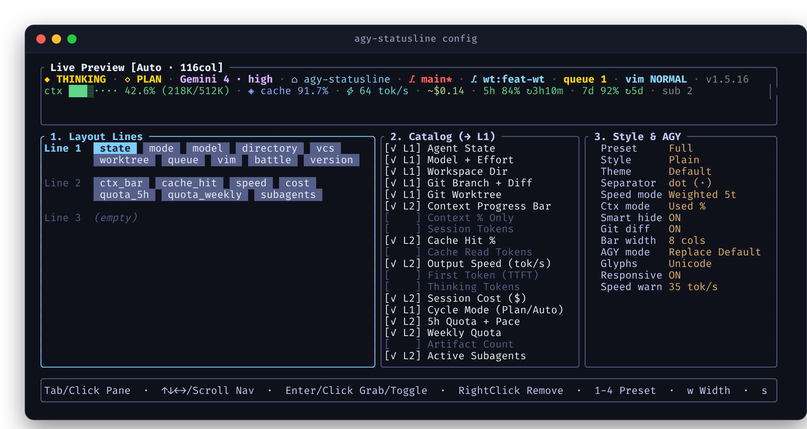
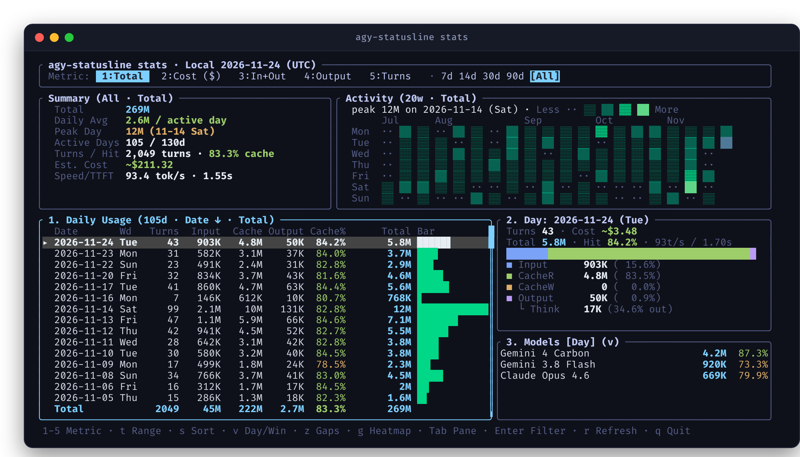

# agy-statusline

[](https://crates.io/crates/agy-statusline)
[](https://github.com/fdkevin0/agy-statusline-rs/actions/workflows/ci.yml)
[](LICENSE)

English | [简体中文](README.zh-CN.md)

Safe Rust (`#![forbid(unsafe_code)]`) statusline and local usage analytics dashboard for Antigravity CLI (`agy`).


## Requirements

- **Antigravity CLI `>= 1.5.15`** (and **Antigravity Desktop `>= 2.35.0`** to include `~/.gemini/antigravity` desktop sessions).

## Install

```sh
cargo install agy-statusline
```

Or download a binary from [GitHub Releases](https://github.com/fdkevin0/agy-statusline-rs/releases), or build from source (Rust 2021; bundles `libsqlite3` by default, pass `--no-default-features` for system `libsqlite3`):

```sh
git clone https://github.com/fdkevin0/agy-statusline-rs.git
cd agy-statusline-rs
cargo install --path . --locked
```

## Quick Start

1. Customize rows, widgets, and theme interactively (`s` saves and registers with AGY):

```sh
agy-statusline config
```



2. Register in AGY `settings.json` and run diagnostics:

```sh
agy-statusline apply --yes
agy-statusline doctor
```

3. Explore local usage, multi-pool quota, speed, cost, and conversation turn breakdowns (interactive TUI on a TTY; `--plain` or `--json` for static output):

```sh
agy-statusline stats
agy-statusline stats --plain --metric cost --days 30
agy-statusline conversations
agy-statusline stats <conversation-id>
```



## Documentation

- [Configuration, Widgets, TUI & Storage Reference](docs/configuration.md) — CLI flags, 33 widgets, 4 presets, 7 themes, keyboard/mouse controls, quota/Hub RPC, pricing, and XDG cache files.
- [Contributing](CONTRIBUTING.md) · [Code of Conduct](CODE_OF_CONDUCT.md) · [Security Policy](SECURITY.md)

## License

[MIT](LICENSE)
