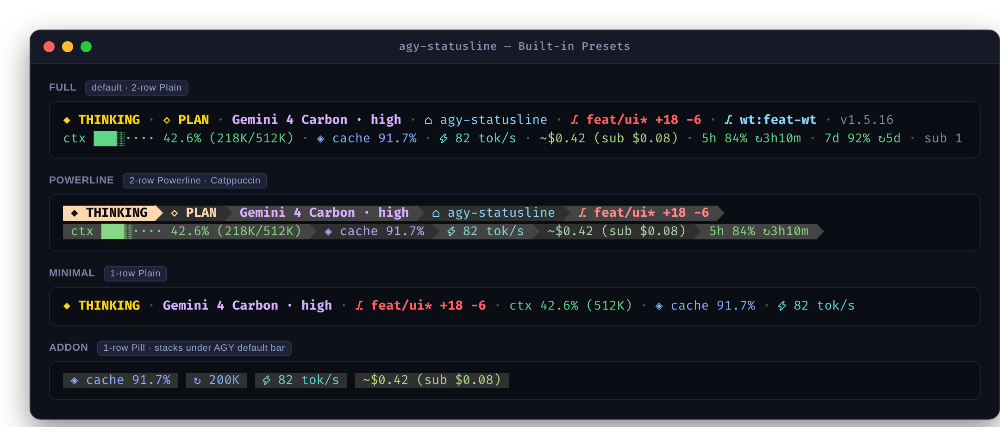

# agy-statusline

[](https://crates.io/crates/agy-statusline)
[](https://github.com/fdkevin0/agy-statusline-rs/actions/workflows/ci.yml)
[](LICENSE)

English | [简体中文](README.zh-CN.md)

A `#![forbid(unsafe_code)]` Rust statusline and local usage dashboard for Antigravity CLI (`agy >= 1.5.15`), with quota pacing, real compaction-threshold sniffing, subagent-aware `models.dev` cost estimation, pure-Rust `.git/HEAD` + worktree awareness, and an interactive 3-pane TUI configurator.



## Requirements

- **Antigravity CLI `>= 1.5.15`** (and **Antigravity Desktop `>= 2.35.0`** for shared `~/.gemini/antigravity` stats), where upstream 500-conversation startup pruning is disabled and `conversations/*.db` serves as the single authoritative usage store.

## Install

```sh
cargo install agy-statusline
```

Or download a prebuilt binary from [GitHub Releases](https://github.com/fdkevin0/agy-statusline-rs/releases), or build from source (requires Rust 2021; `libsqlite3` is bundled by default, pass `--no-default-features` to link system `libsqlite3`):

```sh
git clone https://github.com/fdkevin0/agy-statusline-rs.git
cd agy-statusline-rs
cargo install --path . --locked
```

## Quick Start

1. Configure your layout interactively (keyboard + mouse; press `s` to save and apply in one step):

```sh
agy-statusline config
```


2. Register with AGY (`~/.gemini/antigravity-cli/settings.json`) and verify your setup:

```sh
agy-statusline apply --yes
agy-statusline doctor
```

3. Inspect local CLI & desktop daily/model token usage, cache hit rates, speed, TTFT, and estimated API cost interactively (or pass `--plain` / `--json` for static output):

```sh
agy-statusline stats
agy-statusline stats --plain --metric cost --days 30
```


## Documentation

- [Configuration, Widgets & TUI Guide](docs/configuration.md)
- [Contributing](CONTRIBUTING.md) · [Code of Conduct](CODE_OF_CONDUCT.md) · [Security Policy](SECURITY.md)

## License

[MIT](LICENSE)
