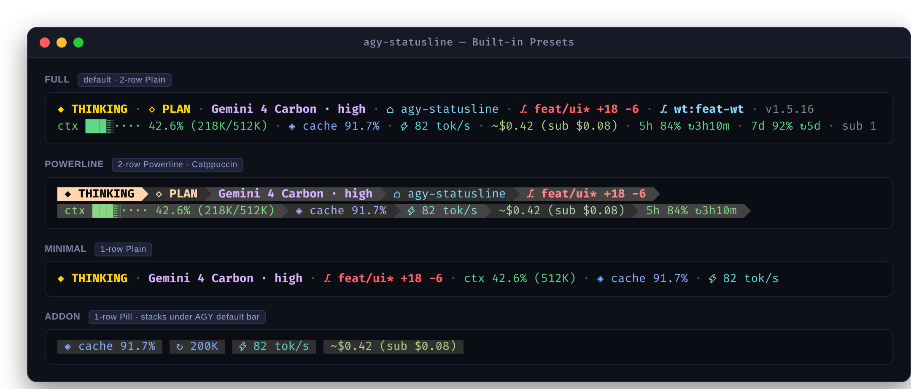
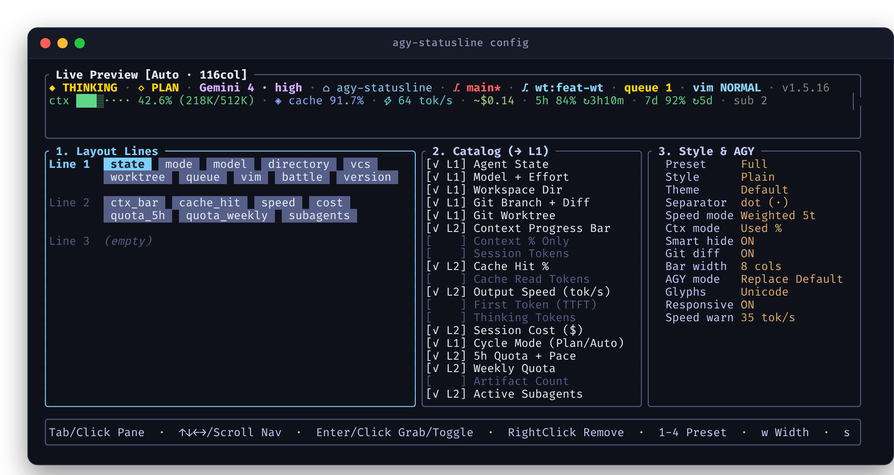
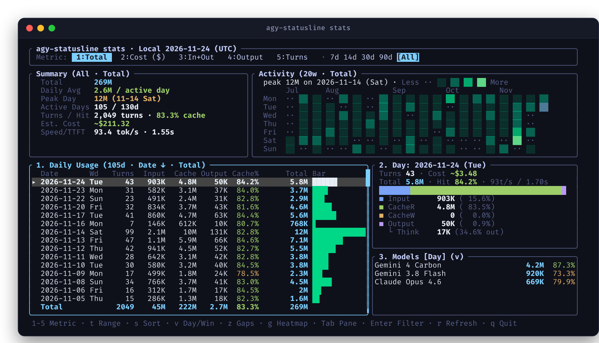

# agy-statusline

[](https://crates.io/crates/agy-statusline)
[](https://github.com/fdkevin0/agy-statusline-rs/actions/workflows/ci.yml)
[](LICENSE)

[English](README.md) | 简体中文

基于纯安全 Rust（`#![forbid(unsafe_code)]`）构建的 Antigravity CLI（`agy`）状态栏与本地用量统计面板。



## 环境要求

- **Antigravity CLI `>= 1.5.15`**（如需合并聚合 `~/.gemini/antigravity` 桌面端会话，需 **Antigravity Desktop `>= 2.35.0`**）。

## 安装

```sh
cargo install agy-statusline
```

也可以从 [GitHub Releases](https://github.com/fdkevin0/agy-statusline-rs/releases) 下载预编译二进制，或从源码构建（需要 Rust 2021；默认内置 `libsqlite3`，传入 `--no-default-features` 可链接系统 `libsqlite3`）：

```sh
git clone https://github.com/fdkevin0/agy-statusline-rs.git
cd agy-statusline-rs
cargo install --path . --locked
```

## 快速开始

1. 启动交互式配置器自定义行布局、组件与主题（按 `s` 一键保存并注册到 AGY）：

```sh
agy-statusline config
```



2. 写入 AGY `settings.json` 并运行环境自检：

```sh
agy-statusline apply --yes
agy-statusline doctor
```

3. 查看本地用量、多池配额、生成速度、估算成本与单会话逐轮明细（终端自动进入交互式 TUI，也支持 `--plain` / `--json` 静态输出）：

```sh
agy-statusline stats
agy-statusline stats --plain --metric cost --days 30
agy-statusline conversations
agy-statusline stats <conversation-id>
```



## 文档

- [配置、组件、TUI 与存储完整参考（英文）](docs/configuration.md) — CLI 参数、33 个组件、4 套预设、7 套主题、键鼠操作、配额/Hub RPC、定价与 XDG 缓存路径。
- [贡献指南](CONTRIBUTING.md) · [行为准则](CODE_OF_CONDUCT.md) · [安全策略](SECURITY.md)

## 许可证

[MIT](LICENSE)
